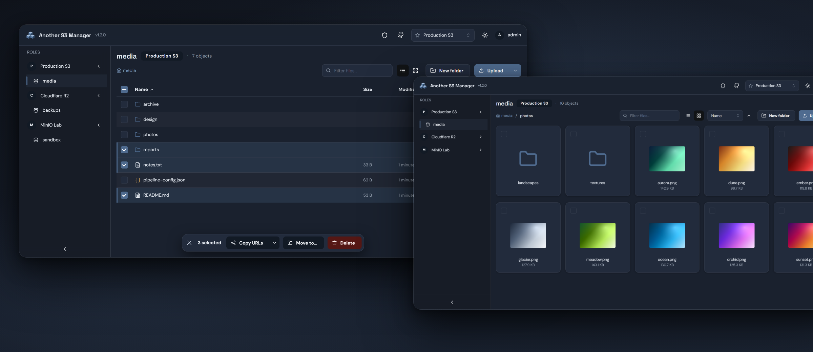

# Another S3 Manager

Lightweight, self-hosted web UI for managing files across multiple S3-compatible storage providers.

Works with **AWS S3**, **MinIO**, **Cloudflare R2**, **Wasabi**, and any S3-compatible API.

<p align="center">
  <a href="https://github.com/kruchenburger/another-s3-manager/releases"></a>
  <a href="https://github.com/kruchenburger/another-s3-manager/actions/workflows/ci.yml"></a>
  <a href="LICENSE"></a>
</p>

<p align="center">
  
</p>

## Quick Start

```bash
docker run -d -p 8080:8080 \
  -e JWT_SECRET_KEY=$(openssl rand -base64 32) \
  -v s3m-data:/app/data \
  ghcr.io/kruchenburger/another-s3-manager:latest
```

The image is about 59 MB compressed (amd64 and arm64).

Open `http://localhost:8080` and log in with `admin` / `change_me_pls`. Persistent state
(SQLite DB, `config.json`, etc.) lives in the `s3m-data` named Docker volume — works out
of the box on Linux/macOS/Windows because Docker initializes named volumes with the
image's user ownership (the container runs as non-root `app` / uid 1001).

If you prefer a host-bind mount (`-v $(pwd)/data:/app/data`), on **Linux** you must
`mkdir -p data && sudo chown 1001:1001 data` first or the non-root user can't write.

For a `docker compose` setup see [`docker-compose.example.yml`](docker-compose.example.yml).

## Features

- **Multi-provider** — connect AWS accounts, MinIO, R2, Wasabi in one UI
- **Multi-account** — switch between roles (default credentials, named profiles, assume role, direct keys)
- **Fast file browser** — table + grid views with image thumbnails; virtualized lists stay smooth in 10k+ object folders
- **Upload & download** — single files, multiple files, or entire folders; drag-and-drop supported
- **Folders** — New folder, Move to… with an optional new name, multi-select and drag-and-drop moves
- **Bulk operations** — multi-select with bulk delete and bulk link copying
- **File preview** — images, video, PDF and text inline (text extensions are admin-configurable)
- **Share links** — presigned URLs with a configurable lifetime, per-link override up to 7 days
- **Server-side search** — prefix search inside folders too large to load client-side
- **User management** — users are granted roles, and each role can be limited to a list of buckets; configurable password policy, forced first-login password change
- **MCP server** — AI agents (Claude Desktop, Cursor) browse the same storage with the token owner's roles and buckets
- **Observability** — Prometheus `/metrics` with a ready-made Grafana dashboard, optional structured JSON logs (see [docs/observability.md](docs/observability.md))
- **Security** — JWT in an httpOnly cookie, bcrypt passwords, CSRF protection, per-username ban after failed logins
- **Dark / light theme**

Object storage has no native rename or move, so ASM copies objects and then deletes the originals with progress tracking; very large folders beyond `MOVE_MAX_OBJECTS` are better moved with the AWS CLI.

## Alternatives

Other S3 web UIs, and when each one is the better pick:

- **[cloudlena/s3manager](https://github.com/cloudlena/s3manager).** A small Go app, configured entirely through env vars,
  that handles several S3 accounts at once, and also creates and deletes buckets, edits bucket policies and shows
  object versions. It has no login:
  everyone who can reach it sees every account. If you are the only user, it is simpler and lighter than ASM.
- **[Filestash](https://github.com/mickael-kerjean/filestash).** A file manager for many backends (S3, SFTP, WebDAV, FTP
  and more) with pluggable authentication (LDAP, proxy passthrough and more) and plugins. Pick it if S3 is one of several things you need to browse.
- **`mc admin`, the AWS CLI, or a fork of the old MinIO console** (the community console no longer has admin
  screens). For administering the storage itself: buckets, policies, versioning,
  lifecycle, storage users. ASM does none of that.
- **Desktop clients** (Cyberduck, S3 Browser, rclone). Great for one person with their own keys. They can't give
  another person access to one bucket without handing over keys.

ASM is for the case where several people need access to different buckets: users and roles live in the app,
credentials stay on the server, and AI agents connect through MCP with the token owner's roles and buckets.

**What ASM is not:** an admin console. It works with the data inside buckets (browse, upload, move, share) and does
no bucket administration: no creating or deleting buckets, no policies, versioning, lifecycle or encryption settings.
Other limits: a single instance on SQLite and a ~59 MB image. Access control is per bucket: a role cannot be limited
to a prefix, and deletion is switched on or off per instance or per role, not per user.

## Configuration

Configure roles through the web UI (**Admin console → Roles**; global settings live under
**Admin console → Settings**) or by editing `config.json`:

```json
{
  "roles": [
    {
      "name": "AWS Production",
      "type": "assume_role",
      "role_arn": "arn:aws:iam::123456789012:role/S3Access"
    },
    {
      "name": "Dev Account",
      "type": "credentials",
      "access_key_id": "AKIA...",
      "secret_access_key": "..."
    },
    {
      "name": "Local MinIO",
      "type": "credentials",
      "access_key_id": "minioadmin",
      "secret_access_key": "minioadmin",
      "endpoint_url": "http://minio:9000",
      "path_style": true
    }
  ]
}
```

Role types: `default`, `profile`, `assume_role`, `credentials`. Any role can include `endpoint_url`, `use_ssl`, `verify_ssl`, `path_style` for S3-compatible services.

Any role may set `"allow_delete": false` to block deleting files and folders
through ASM, including moves and cleanup of partial copies. It defaults to
`true` when absent and applies to everyone using the role, including admins.
The instance-wide `DISABLE_DELETION` / `disable_deletion` gate still wins.
This permission does not prevent uploading or copying over an existing key.
Omitting the field when saving an existing role preserves its current value.

### Upload limits

The maximum upload size is the admin-editable `max_file_size` config field
(Settings → General), falling back to the `MAX_FILE_SIZE` env var (default
100 MB). Uploads are guarded **before the request body is read**:

| Status | Meaning                                                     |
| ------ | ----------------------------------------------------------- |
| `401`  | No or invalid session — the body is never received          |
| `411`  | Missing `Content-Length` (chunked uploads are not accepted) |
| `413`  | Declared or actual size exceeds `max_file_size`             |

Uploads stream to S3 via managed multipart, so files larger than 5 GB are
supported up to `max_file_size` (S3's per-object maximum is 5 TB). The MCP
`upload_file` tool uses a separate base64 path and keeps a 5 GB ceiling.

## Environment Variables

| Variable                          | Description                                                                                                                                                      | Default              |
| --------------------------------- | ---------------------------------------------------------------------------------------------------------------------------------------------------------------- | -------------------- |
| `JWT_SECRET_KEY`                  | **Required.** Secret for JWT tokens                                                                                                                              | —                    |
| `ADMIN_PASSWORD`                  | Admin password — seeds the admin on first boot and re-applies on change, until the password is set from the UI or CLI (see [Authentication](#authentication))    | `change_me_pls`      |
| `ADMIN_PASSWORD_FORCE`            | One-shot override: `1`/`true`/`yes` makes the next start apply `ADMIN_PASSWORD` even over a UI- or CLI-set password. Remove it afterwards                        | unset                |
| `PORT`                            | Server port                                                                                                                                                      | `8080`               |
| `AWS_REGION`                      | Default AWS region                                                                                                                                               | from env             |
| `DATA_DIR`                        | Directory for SQLite DB and runtime data                                                                                                                         | `/app/data`          |
| `MAX_FILE_SIZE`                   | Max upload size in bytes                                                                                                                                         | `104857600` (100 MB) |
| `DISABLE_DELETION`                | Disable delete operations                                                                                                                                        | `false`              |
| `COOKIE_SECURE`                   | Auth cookie `Secure` flag — set to `false` for local HTTP, `true` for HTTPS prod                                                                                 | `true`               |
| `JWT_ACCESS_TOKEN_EXPIRE_MINUTES` | Session lifetime in minutes                                                                                                                                      | `180`                |
| `PRESIGNED_URL_DEFAULT_TTL`       | Default share-link lifetime in seconds                                                                                                                           | `3600`               |
| `PRESIGNED_URL_MAX_TTL`           | Max share-link lifetime in seconds (7-day SigV4 ceiling)                                                                                                         | `604800`             |
| `ENABLE_LAZY_LOADING`             | Lazy loading for large file lists                                                                                                                                | `true`               |
| `LOG_FORMAT`                      | Log output: `text` or `json` (for log aggregators)                                                                                                               | `text`               |
| `ACCESS_LOG_EXCLUDE_PATHS`        | Comma-separated paths whose successful (status < 400) access logs are dropped — silences health-check / uptime-monitor / Prometheus-scrape noise. Empty logs all | `/,/health,/metrics` |
| `METRICS_PASSWORD`                | Basic-auth password for `/metrics` (endpoint is open if unset)                                                                                                   | —                    |

### Optional OpenID Connect configuration

OIDC is opt-in: set `OIDC_ISSUER`, `OIDC_CLIENT_ID` and the canonical origin
`PUBLIC_URL` (no path, query or fragment). The callback is
`PUBLIC_URL/api/auth/oidc/callback`; request Host/forwarded headers are never used.
`OIDC_CLIENT_SECRET_FILE` takes precedence over `OIDC_CLIENT_SECRET`, and an
unreadable secret file fails validation. Secrets belong only in environment/files.
HTTPS requires `COOKIE_SECURE=true`. Development HTTP requires the explicit
`OIDC_ALLOW_INSECURE_HTTP=true` flag.

`OIDC_ALLOWED_PRIVATE_ORIGINS` is an optional comma-separated list of exact
scheme/host/effective-port origins, without paths, userinfo or wildcards. Private
IdPs need this permission even in HTTP development mode. Discovery, JWKS and
code exchange use verified TLS, no redirects/proxy environment, validated DNS
and pinned connections, a 5-second timeout and a 1 MiB streamed response cap.

Policy is stored in `config.json` under `auth`. Omitted nested fields are
preserved on update; invalid startup/reload/save candidates are refused.
The admin UI displays SSO settings read-only and never exports environment secrets.

```json
{
  "auth": {
    "local_login": "all",
    "oidc": {
      "display_name": "Company SSO",
      "scopes": ["openid", "profile", "email"],
      "username_claim": "preferred_username",
      "groups_claim": "groups",
      "session_max_minutes": null,
      "role_mapping": {
        "mode": "sync",
        "require_match": true,
        "rules": [
          {
            "claim": "groups",
            "value": "/team/data",
            "roles": ["existing-s3-role"]
          }
        ]
      }
    }
  }
}
```

`LOCAL_LOGIN=all|admins|off` overrides `auth.local_login` (default `all`). An IdP
outage never re-enables local login; `off` without configured OIDC is invalid.
Session lifetime is a strict integer 1–10080 minutes, default effective 180;
`null` inherits `JWT_ACCESS_TOKEN_EXPIRE_MINUTES` within the same bounds.
Mapping matches literal ID-token claims; `/team/data` is different from `data`.
Use the actual dotted claim path in rules when changing `groups_claim`.
No effective mapping match denies login in both modes. `sync` replaces grants at
accepted login; `initial` preserves existing manual grants but still checks
eligibility. A mode switch applies per account at its next accepted SSO login.
Applied-sync access, including MCP tokens, expires exactly seven days after that
login; config changes, PAT use and Enable do not renew it. There is no freshness
override or background IdP synchronization. UserInfo and RP logout are unsupported.

## Authentication

Login issues an `httpOnly + Secure + SameSite=Strict` cookie carrying a JWT.
The cookie is **not accessible to JavaScript** (XSS-safe). CSRF protection
via `X-CSRF-Token` header on mutating requests; the CSRF token comes from
`/api/me` after login.

For local HTTP development, set `COOKIE_SECURE=false` or the browser will
silently drop the cookie (Secure flag requires HTTPS).

### Admin password

The built-in `admin` user is created on first startup with the password from `ADMIN_PASSWORD`
(default `change_me_pls` — change it).

- **Change `ADMIN_PASSWORD` and restart** and the new value is applied. Rotation works.
- **Change the password in the web UI** (or with the reset CLI below) and the database wins from
  then on: `ADMIN_PASSWORD` will not silently revert a password you chose yourself. To hand
  management back to the environment, set `ADMIN_PASSWORD_FORCE=1` alongside `ADMIN_PASSWORD` for
  one restart, then remove it — while it is set, the environment overrides the UI on every boot.

The app tells you which of these is in effect at startup, so if `ADMIN_PASSWORD` isn't doing what
you expect, the logs say why and what to do about it.

#### Lost the admin password?

Reset it from inside the container:

    # Interactive — hidden prompt, asked twice (keeps it out of your shell history):
    docker compose exec app python -m another_s3_manager.reset_admin_password

    # Non-interactive (scripts / CI) — note the -T and --yes:
    docker compose exec -T app python -m another_s3_manager.reset_admin_password 'NewPassword1' --yes

It enforces the same password policy as the UI and recreates the `admin` user if it was deleted.

### Brute-force defense

Failed logins for non-admin accounts are tracked per username: **3 failed
attempts within 1 hour → account is banned for 1 hour**. Admins are exempt
(the `admin` username is predictable, and a drive-by attacker could otherwise
lock the only admin out of the system).

There is **no application-level IP rate limit** — for production exposure,
put the app behind a reverse proxy that handles rate-limiting and (optionally)
SSO. See [Production deployment](#production-deployment) below.

## Production deployment

This app is an admin tool, not a public SaaS. The recommended deployment is
**behind an authenticated reverse proxy**:

- **Cloudflare Tunnel + Access** — zero-trust SSO (Google, GitHub, email magic
  link) gates `/login` before the request reaches the app. The login form is
  invisible to unauthenticated visitors. Free tier covers small teams.
- **nginx / Traefik / Caddy with basic-auth or OIDC** — same idea, self-hosted.
- **Cloudflare WAF rule** — if you cannot put SSO in front, add a WAF rule
  rate-limiting `POST /api/login` at the edge (e.g. 10/minute per IP).

For self-hosting on a single machine without external traffic, bind to
`127.0.0.1` and use SSH tunnels or a local-only reverse proxy.

## Storage

User accounts, ban records, and authentication state live in a SQLite database
(`<DATA_DIR>/another_s3_manager.db`). On first startup, if legacy
`users.json` or `bans.json` files are present, they are auto-imported
into the database and renamed to `*.migrated.bak` (kept as backup).

Configuration (`config.json`) remains a file — it's admin-edited
infrequently and benefits from human readability.

DB schema is managed via Alembic. Migrations run at startup
(`alembic upgrade head`).

**Upgrading from v0.1.x?** The upgrade is seamless (same volume, same env),
with one caveat: the container now runs as a non-root user, so a data volume
created by v0.1.x needs a one-time ownership fix. See the upgrade note in
[CHANGELOG.md](CHANGELOG.md).

## Docker Compose

Two compose files ship with the repo:

- [`docker-compose.yml`](docker-compose.yml) — local dev. Builds the image from source,
  bind-mounts `./data` for persistence.
- [`docker-compose.example.yml`](docker-compose.example.yml) — self-host template. Pulls a
  published image from GHCR. Copy this onto a server, set `JWT_SECRET_KEY`, run.

For per-developer overrides (mounting `~/.aws` for SSO profiles, custom volumes, etc.)
copy [`docker-compose.override.example.yml`](docker-compose.override.example.yml) to
`docker-compose.override.yml` (gitignored, auto-loaded by compose).

## Kubernetes

The container is Kubernetes-ready: read-only `config.json` mount via ConfigMap is supported,
SQLite DB lives under `DATA_DIR` (mount a PVC there), and secrets like `JWT_SECRET_KEY` come
from env. No Helm chart is published yet.

## Development

```bash
uv sync --all-extras     # install dependencies (including dev: ruff, pytest, moto)
uv run pytest --cov      # run tests
uv run ruff check .      # lint
uv run ruff format .     # format
```

Local server (no Docker):

```bash
JWT_SECRET_KEY=dev-secret uv run python -m another_s3_manager.main
# Persists SQLite + config.json under ./data (per .env.example)
```

**Accessibility:** see [`docs/accessibility.md`](docs/accessibility.md) for the
WCAG 2.1 AA baseline (axe-core via Playwright) and how to run the a11y spec
locally.

See [`docs/testing-backends.md`](docs/testing-backends.md) for the MinIO vs ministack (AWS-native assume_role / credentials) test backends.

## IAM Policy

Minimum permissions for full functionality:

```json
{
  "Version": "2012-10-17",
  "Statement": [
    {
      "Effect": "Allow",
      "Action": ["s3:ListBucket"],
      "Resource": "arn:aws:s3:::YOUR-BUCKET"
    },
    {
      "Effect": "Allow",
      "Action": [
        "s3:GetObject",
        "s3:GetObjectVersion",
        "s3:PutObject",
        "s3:DeleteObject"
      ],
      "Resource": "arn:aws:s3:::YOUR-BUCKET/*"
    }
  ]
}
```

What each action powers:

- `s3:ListBucket` (on the bucket ARN) — browsing files.
- `s3:GetObjectVersion` (optional) — lets MCP moves on versioned buckets copy the exact source version; without it they fall back to an unpinned copy guarded by the source ETag.
- `s3:GetObject` — download / preview, object metadata, presigned share links, and the **source** of a copy/move.
- `s3:PutObject` — upload, and the **destination** of a copy/move.
- `s3:DeleteObject` — delete, and the source-removal half of a move/rename.

For a **read-only** deployment (or read-only MCP tokens), `s3:ListBucket` + `s3:GetObject` alone are enough.

Add `s3:ListAllMyBuckets` on `*` if you don't want to manually specify allowed buckets per role.

## MCP server (for AI agents)

another-s3-manager exposes an MCP (Model Context Protocol) server at `/mcp`,
allowing AI agents (Claude Desktop, Cursor, Codex) to interact with your S3
storage using the same roles and bucket access as the token's owner in the web UI.

Quick start: log in → User menu → MCP tokens → create. Copy the plaintext
token once, paste into your AI agent's MCP config.

See [docs/mcp-setup.md](docs/mcp-setup.md) for client-specific configurations
and security best practices.

## License

[MIT](LICENSE)
